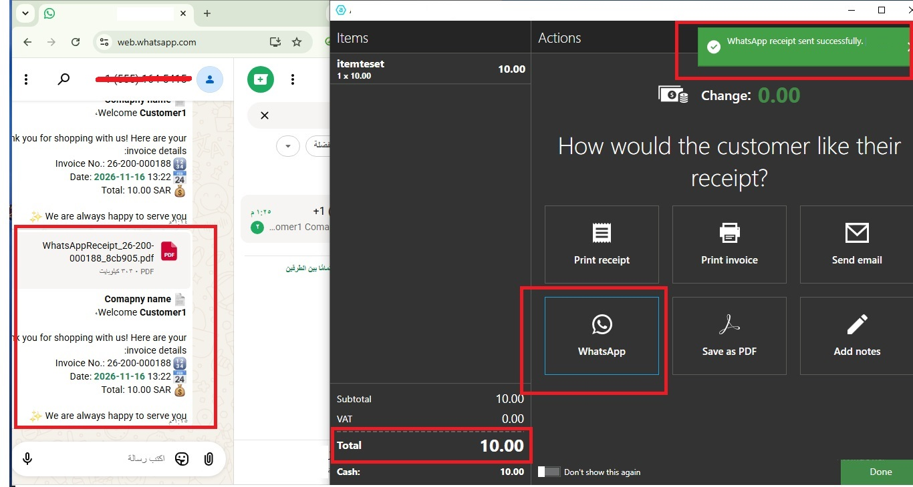

# WhatsApp Receipt Plugin for Aronium POS

**Deliver sales receipts to customers as PDF documents through WhatsApp.**

WhatsApp Receipt Plugin is an independent add-on for Aronium POS. It is intended to help participating stores deliver a copy of a sales receipt to a customer's WhatsApp number.

  

> **Release status:** This repository is currently in a pre-release / targeted early-access phase. Public download will be enabled only after the release package, installation procedure, compatibility, and security checks have been verified for general release. Do not treat this repository template as a public stable release.

## Demo

See how the plugin integrates with Aronium POS and delivers receipts to WhatsApp:

[Watch the product demo on YouTube](https://youtu.be/ULREzw3dT6M)

## What it does

- Prepares a sales receipt as a PDF for WhatsApp delivery.
- Provides plugin settings under **Aronium > Settings > WhatsApp Integration** for the store's WhatsApp Business API credentials and activation.
- Supports the product's licensing workflow.

Feature availability depends on the published version. Refer to each release's notes.

## Download

[View all releases](https://github.com/MODSharf/WhatsAppReceiptPlugin/releases)

When a release is published, download the installer asset `WhatsAppReceiptPlugin-vX.Y.Z.exe` attached to the release. Do not download the repository source ZIP as an installer.

## Requirements

Confirm the exact supported versions before publishing a public release:

- Aronium POS Lite
- Windows
- WhatsApp Business Platform / Cloud API configuration: required for the supported API-based sending flow
- Meta sending number identifier (id)
- Store-owned WhatsApp Business assets and valid credentials

## Installation

See [Installation Guide](docs/INSTALLATION.md). The installation steps are currently being validated with targeted early-access users prior to general public release.

## WhatsApp setup, privacy, and responsibility

Each store must use and manage its own WhatsApp Business assets, phone number, access credentials, customer consent, and compliance with applicable Meta policies, local data-protection laws, and messaging fees.

See [Privacy and Security Notes](PRIVACY-AND-SECURITY.md) for handling guidelines and pre-release notes. Never post access tokens, app secrets, phone-number IDs, customer phone numbers, or receipt PDFs in public issues. For private security or vulnerability reports, contact `mohmdsharf30@gmail.com`.

## Support

- [Report a bug](https://github.com/MODSharf/WhatsAppReceiptPlugin/issues/new?template=bug_report.yml)
- [Request a feature](https://github.com/MODSharf/WhatsAppReceiptPlugin/issues/new?template=feature_request.yml)
- Before opening an issue, remove tokens, customer details, and other confidential information from logs and screenshots.

## Licensing and commercial use

This is an independently developed third-party add-on. Commercial licensing, redistribution, and reseller permissions are governed by the licence or agreement supplied with each release. **No open-source licence is granted by this repository unless a licence file is explicitly added.**

## Disclaimer

WhatsApp Receipt Plugin is not affiliated with, endorsed by, or officially supported by Aronium or Meta. Aronium and WhatsApp are trademarks of their respective owners.