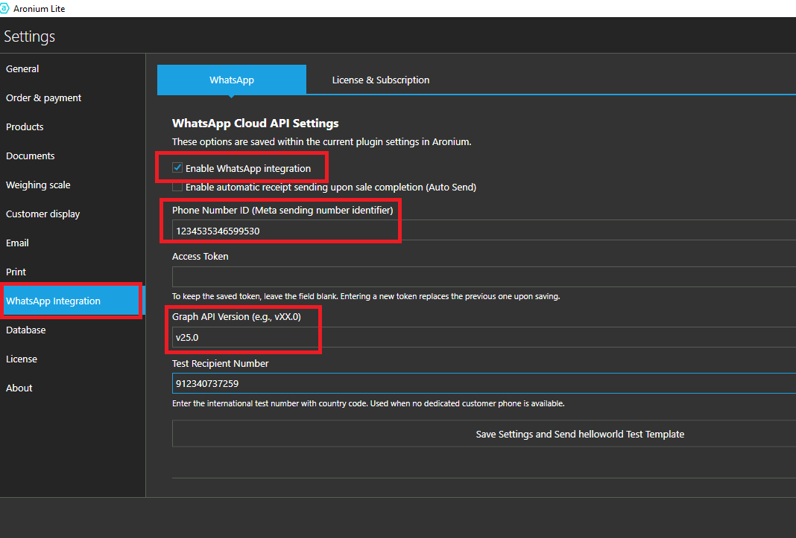
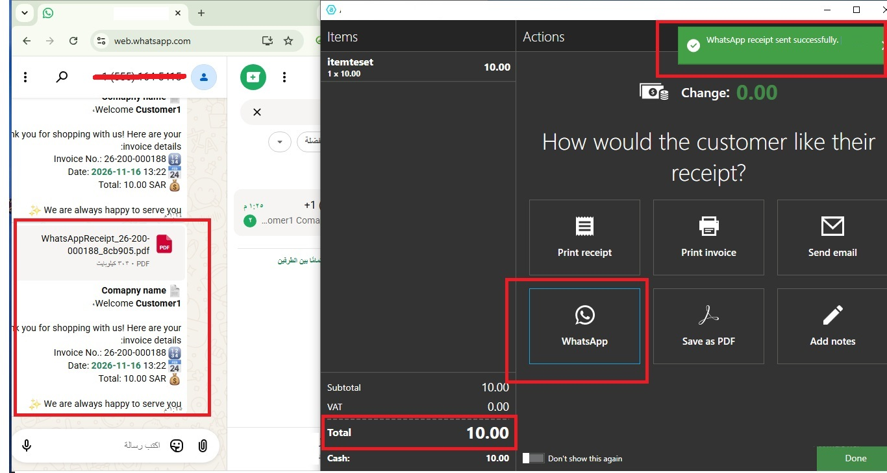

# Installation Guide

## Before you begin

- Back up the Aronium data and configuration as appropriate.
- Close Aronium completely before installing, updating, or uninstalling the plugin.

## Video walkthrough

Watch how to download the release from GitHub, install it on Windows, and enable the integration in Aronium:

[Watch the installation video on YouTube](https://youtu.be/0I-0wSWXwBA)

## Install

1. Download the release asset named `WhatsAppReceiptPlugin-vX.Y.Z.exe` from the GitHub Releases page and run the installer.
2. Start Aronium and navigate to **Aronium > Settings > WhatsApp Integration** to verify that the plugin is loaded.
3. Enter your store's WhatsApp Business API credentials and click the **Enable** button to activate the plugin.

4. Send a test receipt to a consenting test number before enabling normal use.

## Update / uninstall

### Updating
1. Back up your Aronium database and the plugin configuration file (located in `[e.g., %LocalAppData%\Aronium\WhatsAppPlugin\]`).
2. Close Aronium completely.
3. Run the new installer `WhatsAppReceiptPlugin-vX.Y.Z.exe`. Existing settings are preserved automatically during standard updates.
4. Restart Aronium, verify the plugin remains enabled under **Settings > WhatsApp Integration**, and send a test receipt.

### Rollback
If an issue occurs after updating:
1. Close Aronium and uninstall the current version via **Windows Control Panel > Programs and Features** (or **Settings > Apps**).
2. Run the installer for the previous working version (`WhatsAppReceiptPlugin-vX.Y.Z.exe`).
3. Restore your backed-up configuration file if any settings were reset, then re-enable the plugin if needed.

### Uninstalling
1. Close Aronium completely.
2. Open **Windows Control Panel > Programs > Programs and Features** (or **Windows Settings > Apps > Installed apps**).
3. Locate **[WhatsAppReceiptPlugin]** in the list, select it, and click **Uninstall**.
4. *(Optional)* Manually delete any remaining configuration or log files from `[e.g., %LocalAppData%\Aronium\WhatsAppPlugin\]` for a clean removal.

## Troubleshooting

### Log files
Check the Aronium and plugin logs for detailed error messages:
- **Aronium Logs:** `%LocalAppData%\Aronium\Logs\`
- **Plugin Logs:** `[Specify exact path, e.g., %LocalAppData%\Aronium\Logs\WhatsAppPlugin.log]`

### Common issues & recovery

| Issue / Error | Likely Cause | Recovery Steps |
| :--- | :--- | :--- |
| **WhatsApp Integration tab does not appear** | Aronium was open during installation, or required .NET runtime is missing. | Close Aronium, re-run the installer as Administrator, and ensure the required .NET version is installed. |
| **Plugin installed but receipts are not sent** | The plugin was not activated after entering the API details. | Go to **Aronium > Settings > WhatsApp Integration** and ensure the **Enable** button is toggled/clicked. |
| **401 Unauthorized / Invalid Token** | Expired or incorrect WhatsApp Business API Access Token. | Generate a permanent System User Access Token in Meta Business Manager and update the plugin settings. |
| **Message failed to send (Invalid Number)** | Customer phone number lacks the international country code. | Ensure customer phone numbers are saved in full international format (e.g., `9665XXXXXXXX` without `+` or leading zeros). |
| **Template not found / Parameter mismatch** | Approved WhatsApp message template name or language code does not match plugin settings. | Verify that the template is **Approved** in Meta WhatsApp Manager and matches the exact name and parameter count configured in the plugin. |

## Security reminder

Never send your WhatsApp access token or app secret to support. Do not attach real customer receipts or personal data to public GitHub issues.